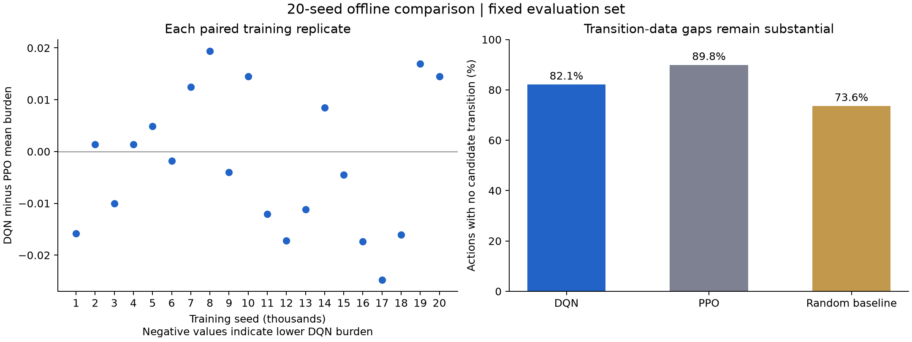

# DQN / PPO / baseline benchmark

This branch adds an **offline experiment**, not a third model in the application.
The existing frozen PPO manifest, model archive, API and UI remain unchanged.

## Implementation

`ml/src/masked_dqn.py` extends Stable-Baselines3 2.9 DQN. It derives the seven-action
mask from the first seven values of each raw observation. The mask applies to:

- Uniform random actions during replay-buffer warm-up.
- Epsilon-greedy exploration and deterministic action selection.
- The target network's maximum over legal actions in replay next states.

Terminal transitions bootstrap exactly zero, including all-resistant states and
the finite-horizon endpoint. A nonterminal state with no legal action is an error.
Replay actions are checked for feasibility. Observation normalization is not
supported because the binary profile supplies the mask. This is vanilla DQN with
masking, not Double DQN or a new biological model.

The implementation follows the [SB3 DQN training path](https://stable-baselines3.readthedocs.io/en/v2.9.0/_modules/stable_baselines3/dqn/dqn.html).
Its MIT attribution is retained in `ml/third-party-notices.txt`.

## Comparison protocol

`ml/src/dqn_benchmark.py` trains fresh DQN models per training seed and compares
them with PPO and the existing random susceptible-action baseline. The pilot
trains fresh PPO comparators. The full protocol reuses the 20 archived PPO models
after verifying checksums, actual training budgets, configurations, simulator/data
manifests and scientific package versions. It reuses
the simulator, reward, profile scheduler, episode metrics and matched-run checks.

Both models use the same scenario, eight-step horizon, 15-value observation,
susceptible-only actions, normalized resistance-burden reward, gamma 1 and hidden
layer widths. Training covers all 127 nonterminal binary profiles in shuffled
cycles. Evaluation covers all 128 profiles, including the zero-action terminal
profile with its existing burden adjustment.

Network, training environment and validation RNGs use each base seed, seed+1 and
seed+2. Models share the training/validation seed design. Evaluation environment
and baseline policy seed blocks are disjoint from those seeds and from each other.
The benchmark checks actual environment-interaction counts; a budget that would
overshoot PPO rollout lengths or DQN collection blocks is refused. It records
training time separately. Equal interaction budgets do not imply equal compute,
parameter counts, gradient updates or hyperparameter tuning effort.

The final checkpoint of each model is evaluated. Best-validation checkpoints are
saved for inspection but do not determine the reported comparison. Both loaded
checkpoint byte sequences are hashed. Each output includes resolved training
configs, metadata hashes, package versions, source hashes and transition-data
fingerprint. Resumption verifies completed outputs and preserves partial work in
an `interrupted/` directory before retrying that seed.

Evaluation uses matched initial profiles and environment seed schedules across
all three strategies. Per-step transition seeds match by step index, but outcomes
can differ because selected actions and candidate transitions differ. This holds
out stochastic draws, not previously unseen profiles. Baseline trajectories are
reused across training replicates; they do not constitute additional independent
baseline samples.

The report shows mean cumulative resistance burden, resistance-emergence event
count, remaining susceptible options, antibiotic exposure, unsupported-step count
and pooled susceptible-action rate. Episode-level means include terminal-start
profiles; rates exclude their nonexistent actions. Means first average profiles
and evaluation seed blocks within each training replicate, then average training
replicates. Paired DQN-minus-PPO differences remain visible per training seed.
There is no automatic winner or significance claim.

## Run

From the repository root, using the existing `.venv`:

```powershell
.\.venv\Scripts\python.exe -B -m ml.src.dqn_benchmark --config experiments/dqn_pilot_config.json --output-dir experiments/runs/dqn-pilot
```

The pilot uses three training seeds, 4,096 interactions per algorithm per seed,
and two evaluation seed blocks: 256 episodes per trained model. It trains a fresh
small-budget PPO comparator; it does not compare a 4,096-step DQN with the
application's approximately 100,000-step PPO checkpoint.

The larger protocol is defined separately:

```powershell
.\.venv\Scripts\python.exe -B -m ml.src.dqn_benchmark --config experiments/dqn_full_config.json --output-dir experiments/runs/dqn-full --workers 3
```

It specifies 20 training seeds, 100,096 interactions per algorithm per seed and
five evaluation seed blocks (640 episodes per model). The budget is divisible by
PPO's 256-step rollouts and DQN's four-step collection blocks. The archived PPO
models requested 100,000 steps and actually completed 100,096; the DQN budget
matches that actual count. DQN settings are an initial protocol, not a tuned model.

Each output directory contains `report.md`, machine-readable `report.json`, a
`status.json`, shared baseline evaluation and separate per-seed model directories.
Those directories include checkpoints, training metrics, validation logs and full
evaluation traces with action, before/after states, CS/XR outcome, transition
support, evidence IDs and probabilities. Generated outputs stay under the ignored
`experiments/runs/` directory; retain a completed run when reviewing its results.
Interrupted or failed runs retain their files and status. Resume a full run with:

```powershell
.\.venv\Scripts\python.exe -B -m ml.src.dqn_benchmark --config experiments/dqn_full_config.json --output-dir experiments/runs/dqn-full --workers 3 --resume
```

Resumption refuses changes to the protocol, source fingerprints, package versions
or base configuration. Completed checkpoints, metadata and evaluation files must
still match their hashes. Parallelism changes only scheduling; each worker uses
one Torch thread and the same per-seed RNG plan.

After completion, audit the saved traces and generate the review artifacts:

```powershell
.\.venv\Scripts\python.exe -B -m experiments.analyze_dqn_study --study-dir experiments/runs/dqn-full --output-dir docs/figures/dqn --candidate-dir artifacts/dqn/dqn_seed_12000
```

The audit verifies completed file hashes, case pairing, feasible actions, unchanged
profiles on unsupported steps and shared per-step transition seed streams. It
exports a figure, per-profile means, action counts and pointwise Student-t intervals
over paired training-replicate means. These intervals assume independent training
replicates and are conditional on the fixed evaluation cases. They do not quantify
uncertainty in the evidence registry or generalization to new profiles; no
multiple-testing-adjusted significance claim is made.

Focused validation:

```powershell
.\.venv\Scripts\python.exe -B -m pytest ml/tests/test_dqn_benchmark.py -q -p no:cacheprovider
```

## Pilot result: 2026-10-23

The three-seed pilot completed and a repeat run reproduced its metrics. The
[recorded result](dqn-pilot-result.json) retains the protocol, checkpoint hashes,
source fingerprints, package versions, per-seed differences and metric summaries.
Local checkpoints and full traces are in
`experiments/runs/dqn-pilot-2026-10-23-verified/`.

| Strategy | Mean burden | Mean emergence events | Mean remaining options | Mean unsupported steps |
| --- | ---: | ---: | ---: | ---: |
| DQN | 3.6440 | 0.1432 | 3.8320 | 6.5990 |
| PPO | 3.7768 | 0.2031 | 3.7096 | 7.1914 |
| Random susceptible baseline | 4.2600 | 0.8359 | 3.1367 | 5.8438 |

Both learned models received 4,096 training interactions per seed. All strategies
had a pooled susceptible-action rate of 1.0 and mean exposure of 7.9375 actions,
including the all-resistant zero-action profile. DQN-minus-PPO mean burden was
-0.231585, -0.090960 and -0.075893 for training seeds 61000, 62000 and 63000.

DQN had lower burden in this pilot, but three small-budget training seeds do not
establish general superiority. Unsupported transitions account for about 83.1%
of DQN actions, 90.6% of PPO actions and 73.6% of baseline actions. A lower burden
can partly reflect avoiding transitions for which data are missing. This needs
explicit attention in the full study; it is not evidence of bacterial clearance
or clinical effectiveness. No model was promoted to the workbench.

## Before application integration

The integration candidate is fixed at training seed **12000**, matching the seed
of the currently served PPO checkpoint. This choice was recorded before reviewing
that DQN seed's full-budget result. It is an engineering candidate; the algorithm
comparison uses the complete 20-seed study. Exporting this checkpoint does not
change the model served by the app.

Review the full study and its per-seed trade-offs, including unsupported steps.
Define and record a validation-only tuning budget before changing hyperparameters;
reserve new evaluation draws if the pilot results inform further tuning. Check
sensitivity to transition assumptions separately from the reference scenario.
If a checkpoint is selected, freeze it with a manifest and hashes, then extend
the API/persistence contracts and UI to represent a collection of strategies
rather than the current PPO/baseline pair. Preserve existing saved runs.

All results describe the simulator. Missing transition evidence is not resolved
by adding DQN, and lower simulated resistance is not evidence of clinical efficacy.

## Full result: 2026-10-23

The full study completed all 20 training seeds. Each DQN model received 100,096
training interactions, matching its verified archived PPO comparator. Each learned
checkpoint was evaluated on 640 matched cases, yielding 12,800 episodes per learned
strategy. The baseline has 640 unique episodes reused across training replicates.

| Strategy | Mean burden | Mean emergence events | Mean remaining options | Mean unsupported steps |
| --- | ---: | ---: | ---: | ---: |
| DQN | 3.6508 | 0.1741 | 3.8373 | 6.5158 |
| PPO | 3.6529 | 0.1895 | 3.8353 | 7.1316 |
| Random susceptible baseline | 4.3114 | 0.8703 | 3.0922 | 5.8391 |

DQN had lower burden in 11 training replicates and PPO in 9. Mean DQN-minus-PPO
burden was -0.002042, with a conditional pointwise 95% Student-t interval of
[-0.008294, 0.004209]. This does not establish superiority or equivalence. The
corresponding intervals for emergence and remaining options also include zero.
Both learned strategies had lower mean burden than the baseline in this evaluation.
All strategies had a susceptible-action rate of 1.0 and mean exposure of 7.9375.

Unsupported steps made up 82.1% of DQN actions, 89.8% of PPO actions and 73.6% of
baseline actions. DQN encountered fewer unsupported steps than PPO in 19 of the
20 training replicates. These counts describe data availability and cannot be
interpreted as successful bacterial clearance.



The audit verified 208,280 actions and 203,200 paired per-step transition seeds.
Completed checkpoint, configuration and evaluation hashes all matched. The
fixed-seed DQN integration candidate was exported to
`artifacts/dqn/dqn_seed_12000/`, with a manifest, training settings, environment
fingerprint and exact checkpoint hash. Its deterministic predictions were checked
on all 127 nonterminal canonical profiles. Load it through
`ml.src.masked_dqn.MaskedDQN.load`; the application still serves its existing PPO
model until the API and UI are extended.

Review records: [study and model provenance](../figures/dqn/study.json),
[audit, conditional intervals, profile means and action counts](../figures/dqn/analysis.json),
and [candidate manifest](../../artifacts/dqn/dqn_seed_12000/manifest.json).
Raw training logs and evaluation traces remain in
`experiments/runs/dqn-full-2026-10-23/`.

Validation: all 555 Python tests passed, including archive verification, action
masking, checkpoint round-trips and refusal to resume changed or corrupted runs.
The original 97-file PPO archive also retains its checksums.
